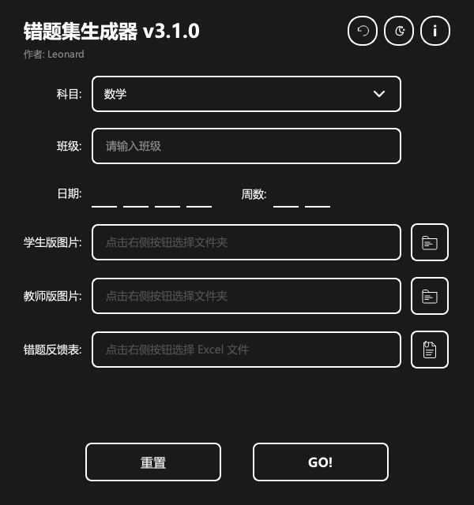

# 错题集生成器

[](https://github.com/Leonardlsa/problems-folder-generator/actions/workflows/ci.yml)
[](https://github.com/Leonardlsa/problems-folder-generator/releases/latest)
[](LICENSE)

根据 Excel 错题反馈表和两套按题号对应的题目图片，一次为每名学生生成**学生版**与**教师版**错题集。



## 下载

请从 [GitHub Releases](https://github.com/Leonardlsa/problems-folder-generator/releases/latest) 下载对应平台的安装包：

| 平台 | 文件 |
|---|---|
| Windows x86_64 | `problems-folder-generator-windows-x86_64.exe` |
| macOS Apple Silicon | `problems-folder-generator-macos-arm64.dmg` |
| macOS Intel | `problems-folder-generator-macos-x86_64.dmg` |
| Linux x86_64 | `problems-folder-generator-linux-x86_64.tar.gz` |

macOS 安装包目前未使用 Apple Developer 证书签名或公证。首次启动时，请在 Finder 中右键应用并选择“打开”。

## 使用方法

1. 填写科目、班级、日期和周数。
2. 选择学生版题目图片文件夹。
3. 选择教师版题目图片文件夹。
4. 选择 Excel 错题反馈表。
5. 点击 **GO!**。

程序会在当前工作目录下生成：

```text
学生/
└── 张三/
    ├── 物理学生版/
    │   └── 第3周错题集.docx
    └── 物理教师版/
        └── 第3周错题集.docx
```

同一名学生的两版文档放在同一目录中，可以直接压缩该学生目录并发送给家长或教师。

## 输入格式

### 题目图片

学生版和教师版目录必须包含相同的题号；图片内容可以不同，扩展名也不必一致。

```text
学生版图片/                 教师版图片/
├── 01.png                  ├── 01.png
├── 02.png                  ├── 02.jpg
└── 03.jpeg                 └── 03.png
```

要求：

- 支持 PNG、JPG、JPEG；
- 文件名主体必须是正整数，例如 `1.png`、`01.png`；
- 同一目录中不能出现重复题号，例如 `1.png` 与 `01.jpg`；
- 两个目录的题号集合必须完全一致。

### Excel 错题反馈表

使用 `.xlsx` 文件。第一列为学生姓名，第二列为错题信息：

| 姓名 | 错题号 |
|---|---|
| 张三 | 1,3,5 |
| 李四 | 全对 |
| 王五 | 未交 |

错题号支持中英文逗号或空格分隔。特殊值：

- `全对`：文档中记录“全对”；
- `未交`、`未带`：两版文档分别插入各自目录中的全部题目图片；
- 空白：文档中记录“无错题信息”。

## 数据安全与恢复

- 每次生成前，程序会备份完整的 `学生/` 目录；
- 点击窗口右上角的恢复按钮，可恢复到上次生成前的状态；
- 学生版与教师版作为同一个快照备份和恢复；
- 文档先写入临时文件，再替换正式文件，降低中途失败造成部分文件损坏的风险；
- 同一周再次生成时，会向已有周文档追加新的日期内容。

## 从源码运行

要求 Python 3.10 或更高版本。

```bash
git clone https://github.com/Leonardlsa/problems-folder-generator.git
cd problems-folder-generator
python3 -m venv .venv

# Linux / macOS
source .venv/bin/activate

# Windows PowerShell
# .venv\Scripts\Activate.ps1

python -m pip install -r requirements.txt
python main.py
```

## 开发与测试

```bash
python -m pip install -e ".[dev]"
python -m pytest -q
```

本项目在 GitHub Actions 中对 Python 3.10、3.11、3.12 运行测试，并自动构建 Windows、Linux、macOS、wheel 与 source distribution 发布产物。

macOS 本地打包：

```bash
./scripts/build_macos.sh
```

版本变更记录见 [CHANGELOG.md](CHANGELOG.md)。

## 项目结构

```text
.
├── main.py                  # GUI 入口
├── core.py                  # 双版本生成与备份恢复逻辑
├── ui/                      # PySide6 界面与图标
├── tests/                   # 回归测试
├── scripts/                 # 各平台打包脚本
└── .github/workflows/       # CI 与自动发布
```

## 许可证

[Apache License 2.0](LICENSE)

## 致谢

项目初版由 **Leonard** 于 2022 年在 **武汉天任教育** 开发，**Lrj** 参与命令行初版开发。
